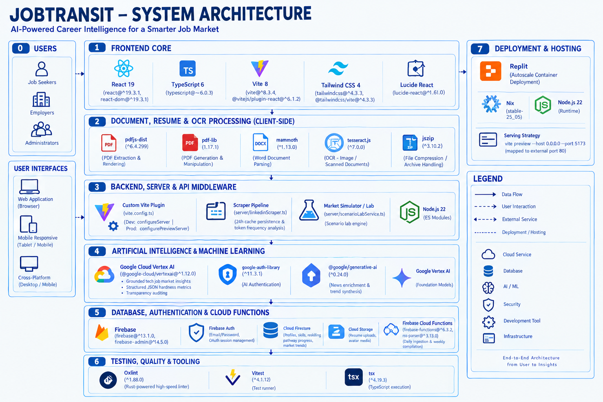

# JobTransit

> An AI-powered transit-styled career navigation and reskilling platform that charts explainable pathways, skill gap bridges, and real-time market signals for the next generation of tech talent.

---

## Team Information

| Field                  | Details                                                                 |
| ---------------------- | ----------------------------------------------------------------------- |
| **Team Name**          | We Need New Laptops                                                              |
| **Team Domain**        | Domain 1 — AI, Smart Society & Future of Work                           |
| **SDG Track (1–17)**   | **SDG 4 — Quality Education** *(Target 4.4)*                            |
|                        | **SDG 8 — Decent Work and Economic Growth** *(Target 8.6)*              |
| **Team Leader**        | Evelyn Ang                                                              |
| **University**         | Universiti Teknologi Malaysia (UTM)                                     |
| **Number of Members**  | 5                                                                       |

## Links

| Resource          | Link                                                                      |
| ----------------- | ------------------------------------------------------------------------- |
| GitHub Repository | [https://github.com/yaotingchun/JobTransit](https://github.com/yaotingchun/JobTransit) |
| Live Demo         | [https://job-transit.replit.app](https://job-transit.replit.app)             |
| Slide Deck        | [View Slides Here](https://github.com/yaotingchun/JobTransit/blob/5d76e09d1c6218b6a1d27fe4679c2296f92b51bf/submission/SDC2026_We%20Need%20New%20Laptops_PitchDeck.pdf) |
| Demo Video        | [View Demo Here](https://youtu.be/_yRJM3CU5C4?si=iBmR_w3MZ-RBuixK) |
| Documentation     | [View Documentation Here](https://github.com/yaotingchun/JobTransit/blob/master/submission/SDC2026_We%20Need%20New%20Laptops_Preliminary%20(2).pdf) |

---

## Overview

### Problem

Artificial intelligence (AI) is transforming the workforce by changing job requirements and the skills needed to remain employable. In Malaysia, **56% of professionals use AI tools at work, yet only 26% have received formal AI training** (Hays Asia Salary Guide 2025). Furthermore, more than **600,000 workers** across strategic sectors will need reskilling within three to five years due to AI, digitalization, and the green economy (BERNAMA / Free Malaysia Today, 2024).

This challenge particularly affects Computer Science students, fresh graduates, early-career developers, and career switchers who must decide which technical skills to develop in a rapidly evolving job market. Without reliable, evidence-based career guidance, traditional learning pathways become outdated and jobseekers risk investing time and resources in skills that do not align with future market demand.

### Solution

**JobTransit** reimagines tech career navigation and reskilling through an interactive transit metaphor (**"Career Metro"**), applying artificial intelligence to resolve workforce AI displacement. Within the Home onboarding terminal, candidates upload resumes in PDF, Word, or image formats. The platform applies client-side OCR and the **Google Gemini API** with structured JSON schemas to extract verified technical competencies, followed by an adaptive questionnaire that dynamically clarifies unmentioned skills without assuming negative ability.

The Transit module visualizes career progressions as an octilinear subway map across five Computer Science lines (**Agentic AI**, **Data**, **Machine Learning**, **Product**, and **Cloud**). Rather than black-box scoring, its reskilling engine generates explainable pathways featuring transparent factor weights (+/- percentage deltas), hands-on capstone projects, and HRD Corp-claimable courses. To ground learning in active labor demand, the Trend radar tracks live LinkedIn postings and hiring momentum, while the Catchup hub runs on serverless Firebase Functions to ingest daily tech news and uses Gemini to generate role-specific "Why It Matters" digests.

### Key Features

- **Interactive Career Metro Map (Transit Map)** — An octilinear subway-style visual graph (0°, 45°, 90°) showing interconnected technical stations, interchange hubs, real-time role demand deltas, and salary benchmarks.
- **Explainable Reskilling Pathways & Learning Plans** — Tailored learning checkpoints featuring transparent match scores (+/- factor weights), curated low-cost/free tutorials, hands-on project deliverables, and verified HRD Corp-claimable courses.
- **Adaptive Skills Clarification Terminal** — An intuitive retro-futuristic transit machine questionnaire that dynamically verifies ambiguous candidate skills with provenance tags (`cv` vs. `user_confirmed`), never assuming negative proficiency.
- **Photorealistic 3D Digital Transit Pass** — A physics-enabled 3D career boarding card with gyroscopic mouse tilt, holographic specular reflections, dynamic QR codes, and real-time Cloud Firestore synchronization.
- **Real-Time Market Trend Radar & LinkedIn Scraper** — Automated market intelligence crawler aggregating live LinkedIn job postings, hiring volumes, emerging skill momentum, and AI exposure indices across target tech roles.
- **Catchup Hub & Daily AI News Digest** — Serverless ingestion pipeline running on Firebase Functions v2 that pulls top tech news, deduplicates articles, and uses Google Gemini to generate role-relevant "Why It Matters" digests.

### Tech Stack

| Layer            | Technology                                                                                                          |
| ---------------- | ------------------------------------------------------------------------------------------------------------------- |
| **Frontend / UI**    | React 19, TypeScript, Vite, Tailwind CSS, Lucide React, Tesseract.js (WASM OCR), `pdfjs-dist`, `mammoth`, 3D CSS transforms |
| **Backend & API**    | Node.js / Express & Vite Dev Server Middleware (`server/linkedinScraper.ts`), Firebase Cloud Functions v2           |
| **Database & Auth**  | Google Firebase: Firebase Auth (User Identity & Sessions) & Cloud Firestore (NoSQL Document Store & Real-time Sync)|
| **GenAI Layer**      | Google Gemini API (Structured JSON schemas for CV parsing, skill extraction, adaptive Q&A, and news synthesis)      |
| **Hosting & Dev**    | Replit (Containerized Deployment, Multiplayer Collaborative Workspace, Secrets Management)                          |

---

## Project Structure

```
JobTransit/
├── docs/                                    # Media, architectural diagrams, and documentation
│   └── README.md
├── server/                                  # Backend scraping and market analysis services
│   └── linkedinScraper.ts                   # Real-time LinkedIn job postings crawler & cache
├── src/                                     # Frontend React application
│   ├── assets/                              # Images, logos, and video backgrounds
│   ├── components/                          # UI components
│   │   ├── auth/                            # Firebase authentication modals and forms
│   │   ├── catchup/                         # Weekly trend digest & news feed cards
│   │   ├── followUp/                        # Machine terminal skills verification questionnaire
│   │   ├── transit/                         # Career Metro Map, 3D Realistic Card, Pathways
│   │   ├── trend/                           # Market intelligence radar & skill demand charts
│   │   ├── Header.tsx                       # Frosted glass top navigation bar
│   │   ├── Homepage.tsx                     # Main dashboard with transit departure board
│   │   ├── Navbar.tsx                       # Floating macOS-style glass navigation dock
│   │   └── ProfileOnboarding.tsx            # Resume upload & OCR processing hub
│   ├── lib/                                 # Shared libraries and utilities
│   │   ├── extractor/                       # Rule-based and LLM resume skill extractors
│   │   ├── cardFirebase.ts                  # Firestore synchronization for 3D transit passes
│   │   ├── cvParser.ts                      # Client-side file extractors (PDF, DOCX, images)
│   │   └── firebase.ts                      # Firebase SDK client initialization
│   ├── App.tsx                              # Core routing and state manager
│   ├── index.css                            # Glassmorphism tokens & TailwindCSS styling
│   └── main.tsx                             # React entrypoint
├── functions/                               # Firebase Cloud Functions (v2)
│   ├── src/                                 # Scheduled news ingestion pipeline & Gemini summarizer
│   └── package.json
├── submission/                              # SDC 2026 required submission documentation
│   ├── SDC2026_JobTransit_Preliminary.pdf     # Preliminary project document
│   ├── SDC2026_JobTransit_TechDeclaration.pdf # Technology declaration document
│   ├── SDC2026_JobTransit_Replit_POU.pdf      # Replit proof of use document
├── tests/                                   # Unit and integration test suites
│   └── extractor.test.ts                    # Extractor & transit line verification tests
├── .env.example                             # Template environment variables
├── .gitignore                               # Git ignore rules
├── .replit                                  # Replit runtime and deployment configuration
├── LICENSE                                  # Apache License 2.0
├── package.json                             # Node.js project manifest & scripts
├── replit.md                                # Replit deployment instructions
├── tsconfig.json                            # TypeScript root compiler configuration
└── vite.config.ts                           # Vite configuration with embedded LinkedIn scraper
```

### System Architecture Diagram



---

## How to Run

### Option 1 — Run on Replit (Recommended)

1. **Open the Replit project.** Visit [Replit](https://replit.com) and open your existing project, or import the repository via **Create Repl → Import from GitHub**: [JobTransit Repository](https://github.com/yaotingchun/JobTransit).

2. **Configure environment variables.** Open **Tools → Secrets** (🔒) in Replit and add the required environment variables. Refer to the [`.env.example`](https://github.com/yaotingchun/JobTransit/blob/master/.env.example) file for the expected configuration.

   **Firebase configuration (frontend):**
   - `VITE_FIREBASE_API_KEY`
   - `VITE_FIREBASE_AUTH_DOMAIN`
   - `VITE_FIREBASE_PROJECT_ID`
   - `VITE_FIREBASE_STORAGE_BUCKET`
   - `VITE_FIREBASE_MESSAGING_SENDER_ID`
   - `VITE_FIREBASE_APP_ID`

   **AI services (backend):**
   - `GOOGLE_APPLICATION_CREDENTIALS_JSON` — Full Google Cloud service account JSON content for Vertex AI access.
   - `GEMINI_API_KEY` — Google AI Studio API key for Gemini API access and fallback functionality.

   **Application configuration:**
   - `VITE_APP_URL` — Public URL of your deployed JobTransit application.

3. **Install dependencies.** Open the Replit Shell and run:

   ```bash
   npm install
   ```

   Alternatively, run `npm ci` if the repository contains a compatible lockfile and you want a reproducible dependency installation.

4. **Start the development server.** Click the green **Run** button or execute the following command in the Shell:

   ```bash
   npm run dev
   ```

   The Vite development server starts on port `5173`, according to the current development configuration. Open the Replit Webview to access and test JobTransit.

5. **Deploy the application.** When the application is ready for production, open **Deployments** (🚀) in Replit and create or redeploy an Autoscale deployment.

   The deployment uses the following configuration:

   - **Build command:** `npm run build`
   - **Run command:** `npm start`
   - **Production start script:** `vite preview --host 0.0.0.0 --port 5173`
   - **Port mapping:** Local port `5173` → external port `80`

   Confirm that the deployment has the required environment variables configured in its own settings. Verify the live application after deployment.

6. **Update the application from GitHub.** To retrieve the latest changes, open the Replit Shell and run:

   ```bash
   git pull origin master
   npm install
   ```

   Then open **Deployments → Redeploy** to publish the updated version. Once deployment completes, hard-refresh the browser using `Ctrl + Shift + R` on Windows or Linux, or `Cmd + Shift + R` on macOS.


### Option 2 — Run Locally

#### Prerequisites
- Node.js `20.x` or higher
- npm `10.x` or higher

```bash
# 1. Clone the repository
git clone https://github.com/yaotingchun/JobTransit.git
cd JobTransit

# 2. Install dependencies
npm install

# 3. Configure environment variables
cp .env.example .env
# Edit .env and supply your Firebase credentials

# 4. Start the development server
npm run dev

# 5. Open the app
# Navigate to http://localhost:5173 in your browser
```
---

## How We Use Replit

Our team utilized Replit as our central collaborative development, staging, and hosting platform throughout the hackathon:

- **Multiplayer Collaborative Development**: Team members worked simultaneously across frontend components, state management, and API endpoints using Replit Multiplayer, drastically accelerating iteration and eliminating merge conflicts.
- **Cloud Hosting & Deployments**: The production preview is deployed directly via **Replit Deployments** as a high-availability static web application configured in [`.replit`](.replit).
- **Instant Cloud Workflows**: Built-in shell commands and port mapping (`port 5173` to external HTTP port 80) enabled friction-free live testing on desktop and mobile browsers.

📄 Proof of use: [`submission/SDC2026_JobTransit_Replit_POU.pdf`](submission/SDC2026_JobTransit_Replit_POU.pdf)

---

## Challenges & Learnings

### Challenges

1. **Client-Side Document Parsing & OCR**: Processing complex multi-column resumes and scanned images directly in the browser without freezing the UI required configuring asynchronous Web Workers with `Tesseract.js` WASM, combined with fallback regex parsers for PDF.js and Mammoth.
2. **Real-Time Market Crawling & Anti-Scraping Defenses**: Fetching live hiring statistics from LinkedIn without incurring aggressive rate limiting required building an intelligent server-side caching layer in server/linkedinScraper.ts that caches results for 24 hours with scheduled background heartbeats.
3. **Idempotent News Pipeline**: Building an automated tech news aggregator required implementing distributed lease locks in Firebase Cloud Functions v2  to prevent concurrent cron invocations from creating duplicate feed articles.

### Learnings

- **Structured GenAI & Schema Constraints**: Gained expertise designing strict JSON schema constraints with the Google Gemini API to extract verified technical skills from unstructured resumes, eliminate hallucinations, and dynamically craft non-penalizing follow-up questions.
- **Explainable AI in Career Guidance**: Discovered that jobseekers trust AI recommendations significantly more when accompanied by explainable weight factors (e.g. `+42% core framework fit`, `-18% missing tool calling evaluation`), rather than black-box percentage scores.
- **Metaphorical UI/UX Architecture**: Validated that anchoring complex data schemas (reskilling roadmaps, role dependencies, salary benchmarks) within a cohesive real-world metaphor ("Transit Subway Map") vastly improves user engagement and reduces career anxiety.

---

## Social Impact & SDG Alignment

JobTransit was created to directly address one of the most pressing socio-economic challenges of the fourth industrial revolution: **the displacement and uncertainty caused by rapid AI automation in the modern workforce**. By transforming ambiguous career anxiety into explainable, structured transit routes, JobTransit advances multiple United Nations Sustainable Development Goals (SDGs) and national economic agendas.

### 1. United Nations Sustainable Development Goals (SDGs)

| Goal / Target | Focus Area | How JobTransit Delivers Impact |
| ------------- | ---------- | ------------------------------ |
| **SDG 8: Decent Work & Economic Growth**<br>*(Target 8.6)* | **Youth Employment & NEET Reduction** | Substantially reduces the proportion of youth not in employment, education, or training by converting academic credentials into verified competency profiles and mapping fresh graduates directly to in-demand AI & tech milestones. |
| **SDG 4: Quality Education**<br>*(Target 4.4)* | **Relevant Skills for Decent Work** | Democratizes technical and vocational upskilling by curating high-quality free/low-cost materials, hands-on portfolio deliverables, and verified government-subsidized programs (**HRD Corp Claimable**), removing financial barriers for learners. |

---

### 2. Impact Baseline & Core Measurable KPIs

| Metric Category | Target / Benchmark |
| --------------- | ------------------ |
| **Target SDG Sub-Targets** | • **Target 8.6**: Substantially reduce the proportion of youth not in employment, education or training.<br>• **Target 4.4**: Substantially increase the number of youth and adults who have relevant technical and vocational skills for employment and decent jobs. |
| **Current Problem Baseline** | In Malaysia, **56% of professionals use AI tools at work, yet only 26% have received training** to use them (Hays Asia Salary Guide 2025). Furthermore, approximately **600,000 workers** across 10 strategic economic sectors need reskilling within 3–5 years due to AI, digitalization, and the green economy (BERNAMA / FMT, 2024). |
| **Core Measurable KPIs** | 1. **Skill Gap Clarification Latency**: Average time (minutes) required for a candidate to identify and confirm their critical technical skill gaps.<br>2. **Reskilling Roadmap Relevancy Rate**: Percentage of generated skill milestones directly matching verified local tech hiring requirements. |
| **Phase 2 Impact Target** | **30% reduction** in the time candidates spend identifying and matching relevant upskilling courses to their career goals by the final prototype presentation, achieved through AI-powered recommendations, skills-gap analysis, and consolidated course information. |

---

### 3. Core Socio-Economic Challenges Addressed

1. **The "AI Displacement Anxiety" Gap**  
   Developers and career starters are overwhelmed by the speed of GenAI automation, creating widespread paralysis and fear of skill obsolescence. JobTransit replaces existential panic with an engaging, structured metaphor—the **Career Metro**—giving users concrete, progressive checkpoints to reach career resilience.

2. **The "Entry-Level Paradox" for Graduates**  
   Fresh graduates encounter entry-level postings demanding 2–3 years of hands-on experience with modern AI stacks. JobTransit resolves this through **Checkpoint Capstones**—practical projects designed with tangible deliverables (e.g. building LangGraph state machines or evaluating hallucination rates with TruLens) that serve as verifiable proof of competency.

3. **Democratizing High-Cost Tech Education**  
   Commercial coding bootcamps frequently charge between RM 8,000 and RM 25,000, excluding low-income and rural talent. JobTransit prioritizes verified free/low-cost learning resources alongside accredited national upskilling funding (**HRD Corp**), ensuring financial constraints never bar career advancement.

4. **Information Asymmetry in the Labor Market**  
   Job seekers often waste months studying outdated libraries or deprecated tools. JobTransit's real-time **Market Intelligence Radar** and LinkedIn scraping engine surface live hiring volumes and skill momentum deltas, aligning learning effort directly with active enterprise vacancies.

---

### 4. Target Beneficiaries & User Personas

```
┌─────────────────────────────────┐   ┌─────────────────────────────────┐   ┌──────────────────────────────────┐
│     Fresh STEM Graduates         │   │    Mid-Career Tech Workers      │   │   Self-Taught / Career Changers      │
├──────────────────────────────────┤   ├─────────────────────────────────┤   ├───────────────────────────────────┤
│ • Facing graduate underemployment│   │ • Legacy software / QA engineers│   │ • Non-CS background seeking entry│
│ • Unsure how to bridge academic  │   │ • High risk of GenAI task shift │   │ • Cannot afford private bootcamps│
│   theory to enterprise AI tools │   │ • Need flexible part-time plans │   │ • Need transparent prerequisites│
│ ➔ Value: Curated project roadmaps│   │ ➔ Value: Modular skill bridge   │   │ ➔ Value: Free curated pathways  │
└─────────────────────────────────┘   └─────────────────────────────────┘   └─────────────────────────────────┘
```

---

## Future Improvements

- [ ] **Apple Wallet & Google Wallet Integration** — Export the 3D JobTransit pass directly as a `.pkpass` / Google Wallet card with dynamic NFC updates when milestones are achieved.
- [ ] **Direct Employer Transit Stations** — Enable verified partner companies to sponsor transit stations with direct interview fast-track boarding passes for candidates who complete specific pathway checkpoints.
- [ ] **Interactive Voice & AI Coding Simulator** — Deploy Gemini Live / Multimodal interactive agents to conduct real-time technical mock interviews for target stations.
- [ ] **Regional Localization** — Expand localized reskilling curriculums and multi-language support (Bahasa Melayu, Mandarin, English) across Southeast Asian tech hubs.

---

## Team

| Name               | Role                                                 |
| ------------------ | ---------------------------------------------------- |
| **Evelyn Ang**     | Team Leader / UI/UX Design & Reskilling Architecture |
| **Chun Yao Ting**  | Full-Stack & AI Pipeline                             |
| **Angela Ngu Xin Yi** | Frontend Lead / 3D Card Engine & Auth             |
| **Teoh Xin Yee**         | Frontend / Trend Radar & Market Intelligence   |
| **Toh Shee Thong**   | Frontend / Weekly Summary & UI Experience          |

---
## Submission Checklist

- [ ] Team name (`JobTransit`), domain (`Domain 1`), and SDG track (`SDG 4` & `SDG 8`) filled in.
- [ ] Slide deck link added and public access verified.
- [ ] Demo video link added and playback verified.
- [ ] Replit used, with proof of use document (`submission/SDC2026_JobTransit_Replit_POU.pdf`) included in `submission/`.
- [ ] RunPod verified as not required (workload handled via Gemini API and Firebase).
- [ ] Preliminary submission completed (`submission/SDC2026_JobTransit_Preliminary.pdf`).
- [ ] Technology declaration completed (`submission/SDC2026_JobTransit_TechDeclaration.pdf`).
- [ ] All submission files renamed with the team name (`JobTransit`) replacing `TeamName`.
- [ ] "How to Run" steps verified locally and on Replit (`npm run build` passing).
- [ ] No API keys or secrets committed to the repository (`.env` ignored in `.gitignore`).

---

## References

1. Hays Malaysia. (n.d.). *AI drives decline in Software Development roles, but Malaysia holds strong as key global skill hub.* Hays Malaysia. [https://www.hays.com.my/press-release/content/future-of-work-malaysia-technology-ai-impact](https://www.hays.com.my/press-release/content/future-of-work-malaysia-technology-ai-impact)
2. Augustin, S., & Free Malaysia Today. (2024, October 10). *600,000 employees need reskilling in 3 to 5 years, says Sim.* Free Malaysia Today. [https://www.freemalaysiatoday.com/category/nation/2024/10/10/600000-employees-need-reskilling-in-3-to-5-years-says-sim](https://www.freemalaysiatoday.com/category/nation/2024/10/10/600000-employees-need-reskilling-in-3-to-5-years-says-sim)

---

## License

This project is licensed under the [Apache License 2.0](LICENSE).
